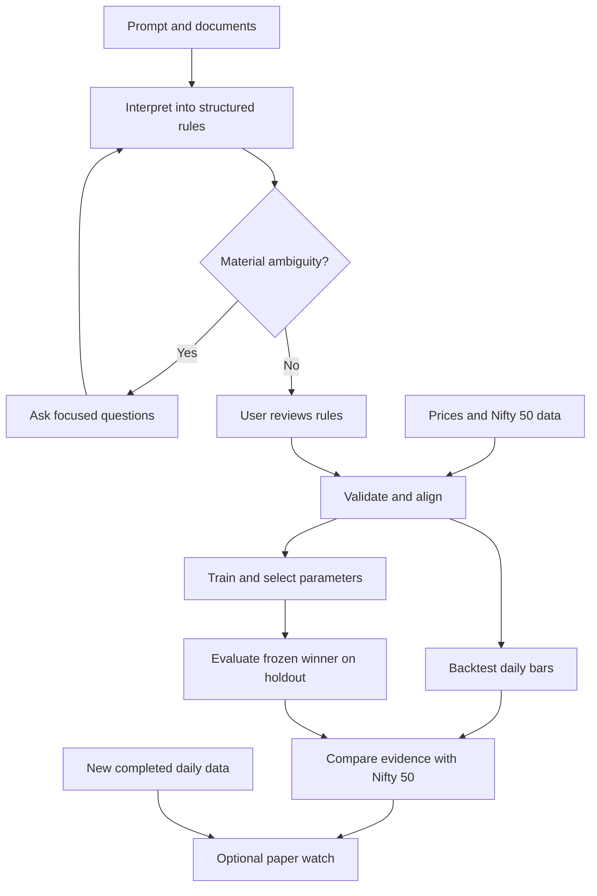

# Niyam

Daily Indian-equity strategy research: describe an idea in Hindi, English or Hinglish, review explicit rules, backtest against **Nifty 50**, and watch newly completed daily bars.

**[Open the public interface](https://whood-yop.github.io/niyam/) · [Open the flowchart](https://whood-yop.github.io/niyam/flowchart.html) · [Download the source](https://github.com/whood-yop/niyam/archive/refs/heads/main.zip)**

The public interface is an open-source project preview. Accounts, private data and calculations run on your **local backend**. GitHub Pages cannot run Python. Its sign-in button opens your local workspace and does not collect passwords on Pages.

## Start locally

1. Install **Python 3.12**. Download and extract this repository.
2. In the extracted project folder, run:

   ```sh
   python scripts/start.py
   ```

   Windows can use `py -3.12 scripts/start.py`.
3. Open **http://127.0.0.1:8000**. Create an account and save the recovery code. Keep the terminal running.

The launcher creates `.venv`, installs pinned dependencies and starts FastAPI on loopback. First installation requires internet; subsequent launches reuse the environment. Templates and account creation need no AI key. Actual backtests need your market files; free-form interpretation needs a configured model.

## Two things to supply

| Input | Location relative to the project folder |
|---|---|
| Daily equity OHLCV | `data/prices/` |
| Nifty 50 **price index** | `data/benchmark/` |
| Optional point-in-time fundamentals | `data/fundamentals/` |
| Model, search and daily-feed connections | Copy `.env.example` to `.env` and fill the relevant values |

The three data directories ship empty apart from Git placeholders. Connection values are blank. Data, credentials, accounts and session state are excluded from Git. Keep them on your computer; do not upload them to the public repository.

[Data format and feed contract](docs/DATA.md) · [Execution methodology](docs/METHOD.md) · [Audit and limits](docs/AUDIT.md) · [Deployment](docs/DEPLOYMENT.md) · [Research and reuse](docs/RESEARCH.md)

## Included

- Responsive strategy studio, editable SMA/RSI/Donchian templates, JSON rule editor and document attachments (text PDF, DOCX, TXT, Markdown).
- Configurable multilingual model interpretation, schema validation and bounded repair, up to two focused clarification questions, optional reference lookup with sources. No generated code execution.
- Daily, long-only Indian cash equities; up to 100 stocks in independent equal initial capital sleeves. Nested conditions, lagged indicators and point-in-time fundamentals.
- Next-open trades; whole shares; fixed/trailing percentage or ATR stops; percentage targets; fees and adverse slippage on both sides.
- Equity/drawdown charts, return, CAGR, volatility, Sharpe, trades, fees, monthly comparison and downloadable reports against Nifty 50 on matching dates.
- Parameter search with a strict earlier training / later validation split. Selection never uses validation performance.
- Local accounts, private strategies/reports, password hashing, hashed sessions and recovery codes.
- Optional daily feed adapter and paper watches, with duplicate-event protection. No broker orders. Daily data does not support real-time intraday stop alerts.

## Workflow



## Performance

NumPy/pandas compute cached indicator arrays; Numba compiles the event loop to native machine code. Approximate work is `O(stocks × bars × expression work)` and `O(trials × stocks × bars × expression work)` for optimisation. Trial scoring skips full chart construction. First-call compilation takes longer than warmed runs.

Reproduce the synthetic workload with `.venv/bin/python scripts/benchmark.py`; measured results and exclusions are in [BENCHMARK.json](docs/BENCHMARK.json). These are measurements of in-memory computation, not an end-to-end latency promise. The canonical dataset is currently held in RAM; vendor-specific parsing and large-data tuning await your files.

## Verify

```sh
python -m pip install -r requirements-dev.txt
python -m pytest -q
npm ci --ignore-scripts
npm test
```

Python tests include an independent Backtesting.py oracle for one matching execution case. DOM tests use jsdom; this does not substitute for visual/browser QA. GitHub Actions runs both suites on pushes.

This version does not implement intraday trading, shorting, derivatives, leverage, dynamic stock ranking or portfolio rebalancing. Unsupported essential rules must be clarified instead of silently approximated. No model can guarantee perfect interpretation of every ambiguous prompt; review the interpreted rules before running.
